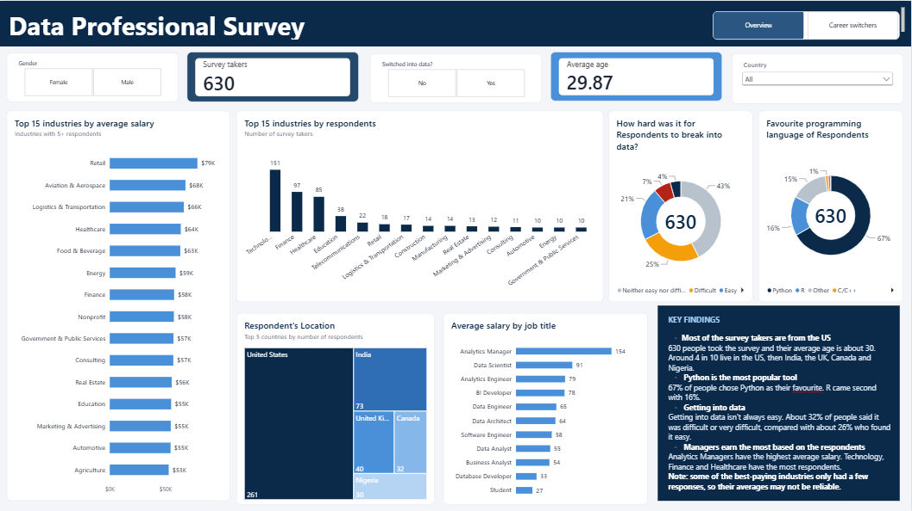
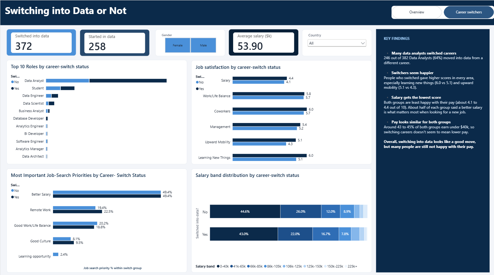

# Data Professional Survey Analysis (Power BI)

**Tools:** Power BI, Power Query, DAX

I built a two-page Power BI dashboard from a survey of **630 data professionals**. I wanted to find out what people in data earn, how hard it was for them to get into the field, what they look for in a job, and whether people who switched careers into data are happy with that choice.

The project started as Alex The Analyst's guided Power BI project. After finishing it, I kept going: I cleaned the data further, fixed messy categories, wrote my own DAX measures and added a second page of analysis.

## Dashboard

### Page 1: Survey Overview

Who answered the survey, where they live, what they earn by job title and industry, their favourite programming tools, and how hard it was for them to break into data.



### Page 2: Career & Workplace Insights

A comparison of people who switched careers into data with people who started there: their roles, salary bands, job-search priorities and satisfaction at work.



### Video walkthrough

A short demo of the slicers, chart interactions and page navigation:

**[▶ Watch the dashboard walkthrough on YouTube](https://youtu.be/XwMSHxm0NR4)**

### Try it yourself

Download [`Data_Professional_Survey_Dashboard.pbix`](Data_Professional_Survey_Dashboard2.pbix) and open it in [Power BI Desktop](https://www.microsoft.com/power-platform/products/power-bi/desktop) (free). Use the buttons at the top right to switch between the two pages.

## Questions I wanted to answer

- How do salaries compare across job titles and industries?
- Which industries do most respondents work in?
- How hard is it to break into data?
- Do career switchers end up in different roles or salary bands from people who started in data?
- What matters most to people when they look for a new job?
- Are career switchers more or less satisfied at work?

## Cleaning the data

Most of my time went into this part. The raw survey data was messier than it first looked.

**Job titles and countries.** Some answers were spelled or worded differently but meant the same thing, so I standardised them. Otherwise the same group would have been split across several rows in the charts.

**Industries.** This was the biggest job. People described their industry in many different ways, and a lot of the categories overlapped. To sort it out, I:

- built a separate **industry mapping table** with each original answer, a cleaned name and a broader industry group
- merged it into the survey data in Power Query
- checked the new columns for blanks and errors

That gave me consistent categories to compare.

**Salaries.** The survey asked for salary ranges (e.g. 41k–65k), not exact figures. I turned each range into its midpoint so I could compare averages. That means every salary figure in this project is an **estimate**, not what someone actually earns.

## DAX measures

I wrote measures for respondent counts, average salaries, industry percentages and salary rankings. A few examples:

**Average salary by industry**

```dax
Average Salary by Industry =
AVERAGE('Data Professional Survey'[Average Salary])
```

**Each industry's share of respondents**

```dax
Respondent Percentage =
DIVIDE(
    [Respondent Count],
    CALCULATE(
        [Respondent Count],
        REMOVEFILTERS('Data Professional Survey'[Cleaned Industry])
    ),
    0
)
```

**Industry salary ranking.** I also ranked industries by average salary. To keep the ranking fair, I only included industries with at least five respondents, and I left out answers that aren't really industries, like Student, Unemployed and Not Specified.

## What I found

**1. Technology had the most respondents.** 151 people work in Technology, followed by Finance (97) and Healthcare (85).

**2. Managers earn the most.** Analytics Managers had the highest estimated average salary at about **$154K**, followed by Data Scientists at about **$91K**. Among industries with at least five respondents, Retail came out on top at about **$79K**, but only a small number of people answered for some of these industries, so I wouldn't read too much into that.

**3. Getting into data isn't easy for everyone.** About **32%** of respondents found it difficult or very difficult to break in. Around 26% found it easy, and 43% said it was neither easy nor difficult.

**4. Everyone wants better pay.** A better salary was the top job-search priority for both career switchers and people who started in data.

**5. Career switchers seem happier at work.** People who switched into data gave slightly higher satisfaction scores in all six areas I looked at. For example:

- **Salary:** 4.4 vs 4.1
- **Coworkers:** 6.0 vs 5.7
- **Upward mobility:** 5.1 vs 4.3

Salary was still the lowest-rated area for both groups, which matches finding 4.

## Limitations

- Salaries are midpoints of ranges, so they're estimates.
- Some industries and job titles had very few respondents.
- The people who took this survey may not represent all data professionals.
- The differences between career switchers and non-switchers show a pattern, not a cause.

## What I learned

This project taught me that the dashboard is the easy part. Most of the work was making the data trustworthy first: cleaning categories, building the mapping table and checking my numbers. It gave me real practice with Power Query, DAX and turning a messy dataset into something people can explore.

## Credit

This project is based on **Alex The Analyst's Data Professional Survey** guided Power BI project. I added the extra data cleaning, the industry mapping, the DAX measures and the expanded analysis. Thanks to Alex for the original project and for his free learning resources.
